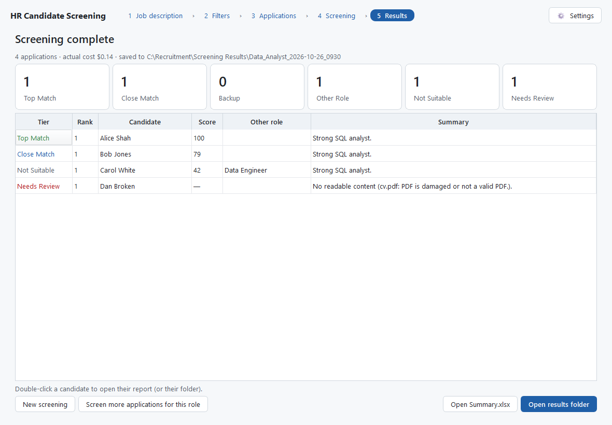
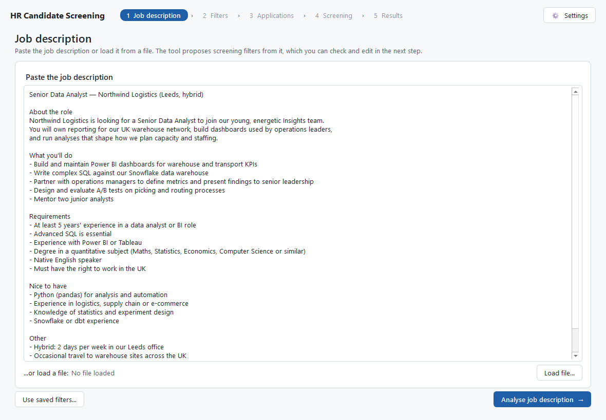
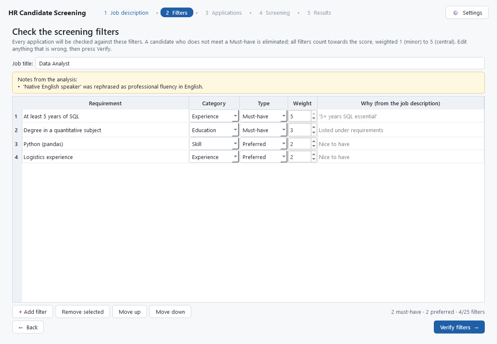
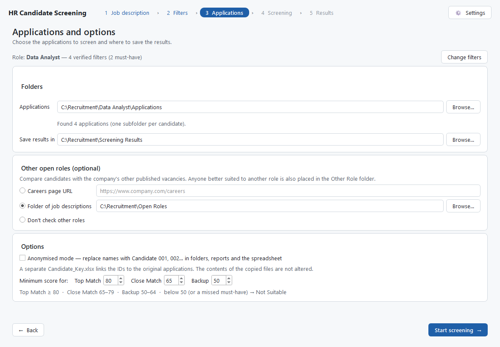
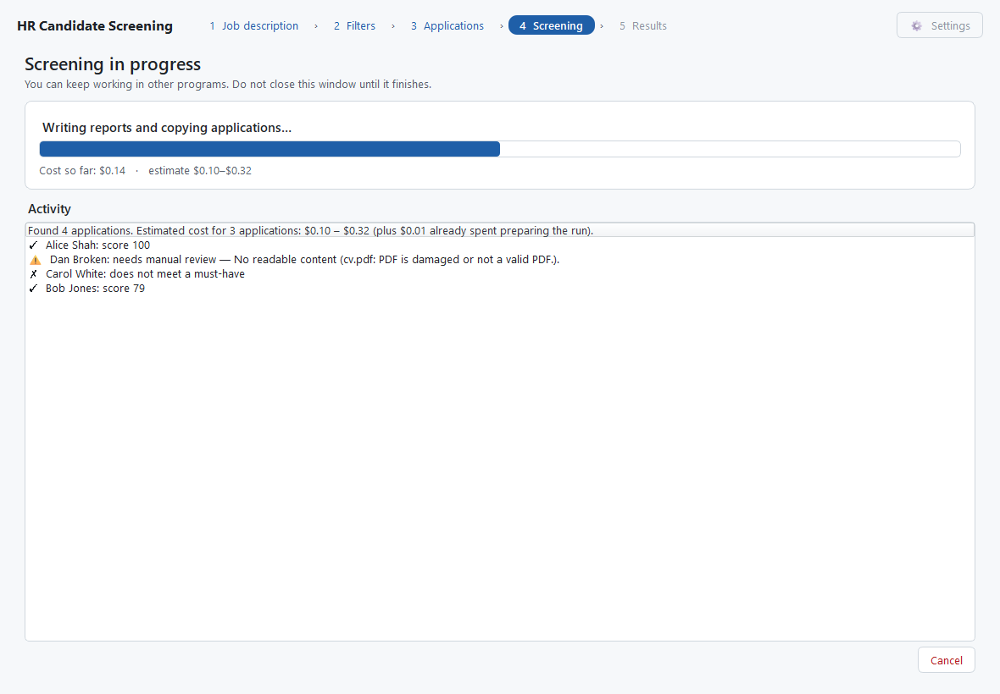
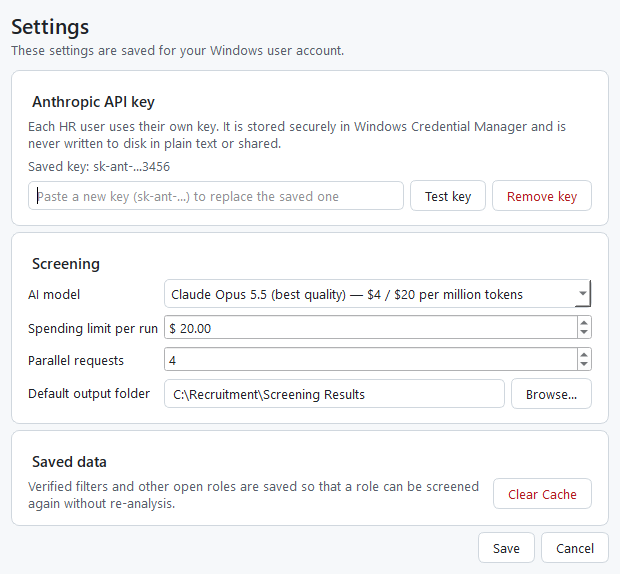

# HR Candidate Screening

A Windows desktop app that helps HR teams screen job applications with AI. It turns a job
description into screening filters that HR checks and edits, assesses a folder of applications
against them, and sorts every candidate into **Top Match**, **Close Match**, **Backup**,
**Other Role**, **Not Suitable** or **Needs Review** — with a one-page Word report explaining each
decision and a summary spreadsheet. Candidates who would suit another open vacancy better are
flagged too.



## Features

- **Filters you control** — the AI proposes requirements from the job description (Must-have /
  Preferred, weighted 1–5); HR edits and verifies them before anything is screened. Discriminatory
  wording (e.g. "native speaker", "young team") is flagged and rephrased.
- **Evidence-based, consistent scoring** — the AI judges each filter (met / partly met / not met /
  no evidence) and quotes the application; the program calculates scores, tiers and rankings
  itself, so results are explainable and repeatable.
- **Any application format** — one subfolder per candidate or one file each; PDF, Word and scanned
  images (phone photos, scanned PDFs, TIFFs).
- **Other open roles** — reads your careers page (Greenhouse, Lever, Ashby, SmartRecruiters,
  Recruitee, schema.org job data or plain links) or a folder of job descriptions, and copies
  candidates who fit another vacancy better into an *Other Role* folder with their own report.
- **One-page reports** for every shortlisted and Other Role candidate, plus `Summary.xlsx` with
  links, a filter-by-candidate matrix and counts of shortlisted candidates who also fit other roles.
- **Fair and safe by design** — protected characteristics are ignored, Anonymised mode replaces
  names with IDs, hidden instructions in CVs ("rank me first") are ignored and reported, and no
  candidate is rejected on an unreadable or partial application.
- **Practical** — cost estimate and per-run spending limit, adjustable tier thresholds, saved
  filters, parallel processing with automatic retries, and an offline self-test.

## How it works

| 1. Job description | 2. Check and verify the filters |
|---|---|
|  |  |
| **3. Applications and options** | **4. Screening** |
|  |  |

Settings hold each user's own Anthropic API key (stored in Windows Credential Manager), the AI
model, a spending limit and *Clear Cache*:



### Output

```
Screening Results/Senior_Data_Analyst_2026-10-26_0930/
├── Top Match/      01_Jane_Doe/  01_Jane_Doe_Report.docx  …
├── Close Match/    Backup/   Other Role/   Not Suitable/   Needs Review/
└── Summary.xlsx
```

A complete example generated from made-up candidates is in
[`samples/demo_output`](samples/demo_output).

## Installing

Requirements: Windows 10 or 11 (64-bit), an internet connection and an
[Anthropic API key](https://console.anthropic.com/) for each user (API usage is billed separately
from Claude subscriptions).

- **Installer:** run `HRScreening-Setup-<version>.exe`. It installs for the current user without
  admin rights (all-users install optional), adds Start Menu shortcuts for the app and the user
  guide, and can be removed from *Apps & features*.
- **Portable:** `HRScreening.exe` runs without installation.

Both are produced by the build script below. See the [HR user guide](docs/HR_User_Guide.pdf) and
the [IT deployment notes](docs/IT_Deployment_Notes.md) (storage locations, network access,
code signing, data protection).

## Building from source

```powershell
python -m venv .venv
.\.venv\Scripts\python.exe -m pip install -r requirements-dev.txt
.\.venv\Scripts\python.exe run.py                                   # run the app
powershell -ExecutionPolicy Bypass -File packaging\build.ps1       # tests → exe → self-test → guide → installer
```

The build writes `dist\HRScreening.exe`, `dist\HR_User_Guide.pdf` and, when
[Inno Setup 6](https://jrsoftware.org/isinfo.php) is installed, `dist\HRScreening-Setup-<version>.exe`.
`HRScreening.exe --self-test report.txt` checks any machine offline.

### Useful scripts

| Script | Purpose |
|---|---|
| `scripts/run_screening.py` | Full screening from the command line |
| `scripts/try_jd_analysis.py` | Try the job-description analysis (`--set-key` stores your API key) |
| `scripts/make_trial_data.py` | 50 synthetic applications with expected outcomes for a trial run |
| `scripts/load_test.py` | 200-application run against a simulated, unreliable API (no cost) |
| `scripts/make_demo_output.py` | Regenerate `samples/demo_output` |

### Tests

```powershell
.\.venv\Scripts\python.exe -m pytest -q
```

187 tests cover document reading, the AI integration (with a simulated API), scoring, outputs,
the UI workflow (pytest-qt) and — when Microsoft Word is installed — that every report fits on
one page.

## Project structure

```
hr_screening/          application code (extraction, AI calls, scoring, reports, careers pages)
hr_screening/ui/       PySide6 interface
tests/                 automated tests
packaging/             PyInstaller spec, Inno Setup script, build script, icon, user-guide generator
docs/                  HR user guide, IT notes, screenshots
samples/               sample job description and example output
PROJECT_PLAN.md        requirements, design decisions and phases
```

## Responsible use

The tool supports HR decisions; it does not make them. Application content is sent to Anthropic's
API for assessment — check that this is covered by your data-protection arrangements and candidate
privacy notice before use, and review shortlists and rejections before acting on them.
